<!-- Header -->
<p align="center">
  
</p>

<p align="center">
  <a href="https://github.com/SrushtiSriDatta">
    
  </a>
</p>

<p align="center">
  <a href="mailto:srushtisridatta26@gmail.com"></a>
  <a href="https://www.linkedin.com/in/srushti-sridatta-65275527b/"></a>
  <a href="https://srushtisridatta.github.io/"></a>
  <a href="https://github.com/SrushtiSriDatta/SrushtiSriDatta/raw/main/Srushti_SriDatta_Resume.pdf"></a>
</p>

<p align="center"></p>

## 💖 About me

<table>
<tr>
<td width="60%" valign="top">

- 🎓 **BE (Honours) in Electronics & Communication**, VTU
- 🔧 Equally at home with **hardware** (circuits, embedded systems) and **software** (web development)
- 💻 Full Stack Web Development Intern at **VrishankSoft Pvt. Ltd.** (Feb–May 2026)
- 🏆 **Altium Global Scholarship 2025** & **Gita Chaitanya Merit Scholarship**
- 📄 Paper published at **ECMI 2026**: *Intelligent Energy Meter System for Theft and Tamper Prevention*
- 📫 **srushtisridatta26@gmail.com**

</td>
<td width="40%" valign="top">

```yaml
name: Srushti SriDatta
role: ECE Engineer
loves:
  - Embedded systems & IoT
  - Edge AI
  - Full-stack web apps
currently_building: ArcScribe
motto: "Bridging circuits and code"
```

</td>
</tr>
</table>

<p align="center"></p>

## 🧰 Tech stack

<p align="center">
  
</p>

<p align="center">
  
  
  
  
  
  
  
  
  
</p>

<p align="center"></p>

## ✍️ Featured: ArcScribe

<table>
<tr>
<td width="140" align="center" valign="middle">
  <a href="https://srushtisridatta.github.io/ArcScribe/"></a>
</td>
<td valign="middle">

**My own free, offline-first handwriting and notes app for tablets**, installable from the browser.
Pressure-sensitive pens, PDF annotation, 19 paper templates, lasso, shapes, rich text, OCR and a study workspace with flashcards and quizzes.
Notes stay on the device.

<a href="https://srushtisridatta.github.io/ArcScribe/"></a>
<a href="https://github.com/SrushtiSriDatta/ArcScribe"></a>

</td>
</tr>
</table>

<p align="center"></p>

## 🚀 Projects

<p align="center">
  <a href="https://github.com/SrushtiSriDatta/Extending-Tamper-Detection-with-Edge-AI"></a>
  <a href="https://github.com/SrushtiSriDatta/WriteHub"></a>
  <a href="https://github.com/SrushtiSriDatta/Smart-Engery-Meter"></a>
  <a href="https://github.com/SrushtiSriDatta/ArcScribe"></a>
</p>

| Project | What it does | Tech |
|---------|--------------|------|
| [**ArcScribe**](https://github.com/SrushtiSriDatta/ArcScribe) | Offline-first handwriting & notes app for tablets (PWA) | JavaScript, Canvas, IndexedDB, PDF.js |
| [**Extending Tamper Detection with Edge AI**](https://github.com/SrushtiSriDatta/Extending-Tamper-Detection-with-Edge-AI) | ML-based tamper/theft detection for smart energy meters, deployed as a quantized model for edge inference | Python, TensorFlow, scikit-learn, TFLite |
| [**WriteHub**](https://github.com/SrushtiSriDatta/WriteHub) | Full-stack blog platform with admin dashboard, comments, search and contact form | Node.js, Express, MongoDB, EJS |
| [**Smart Energy Meter**](https://github.com/SrushtiSriDatta/Smart-Engery-Meter) | IoT energy meter with theft detection, GSM alerts & ThingSpeak cloud monitoring (EMIC 2026) | ESP32, Arduino, GSM, ThingSpeak |
| **WiFi Secure Communication Using RSA** | Secure WiFi communication using RSA public-key cryptography with encryption and authentication | ESP32, C++, RSA |
| **Traffic Control System** | 8052 microcontroller traffic-light system simulated in Multisim, written in assembly | 8052, Multisim, Assembly |

<p align="center"></p>

## 📜 Certifications

<p>
  
  
  
  
</p>

<p align="center"></p>

## 📈 GitHub stats

<p align="center">
  
  
</p>

<p align="center">
  
</p>

<p align="center">
  
</p>

<!-- Footer -->
<p align="center">
  
</p>
